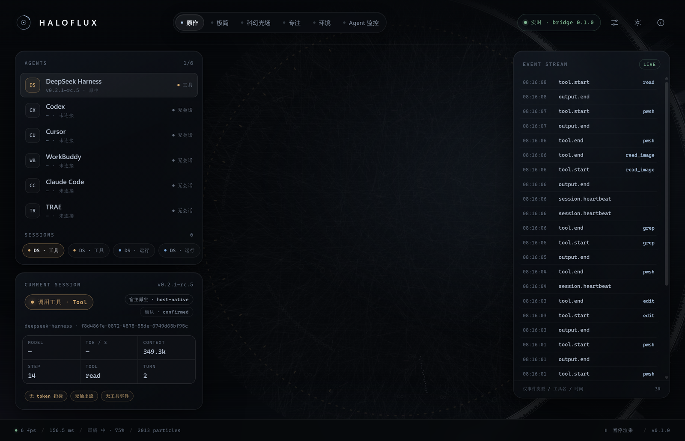
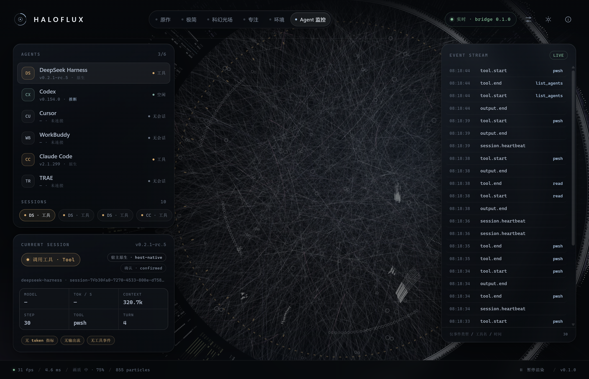
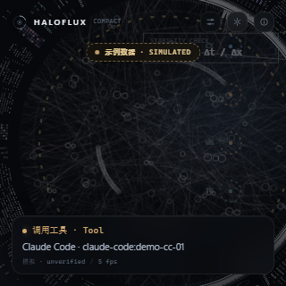
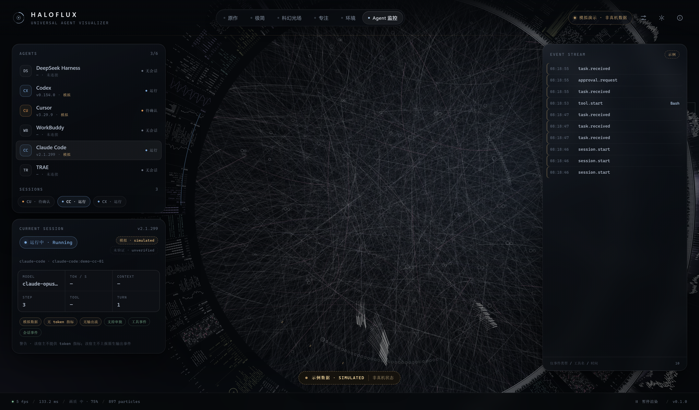
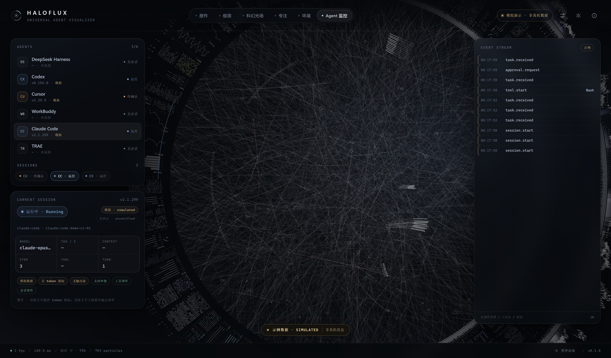
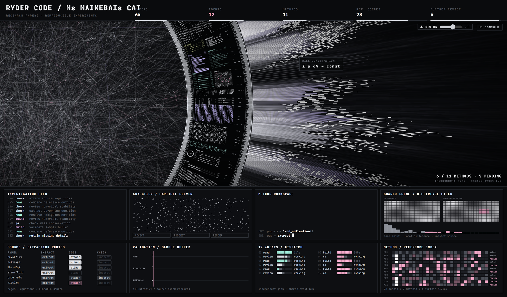

# HALOFLUX Universal Agent Visualizer

[](https://github.com/LYL-Z/haloflux-universal/actions/workflows/ci.yml)
[](https://lyl-z.github.io/haloflux-universal/)

> One visual engine for six agent hosts: DeepSeek Harness, Claude Code, Codex, Cursor, WorkBuddy and TRAE.
> **Personal, noncommercial use only (PolyForm Noncommercial 1.0.0).**

**Live demo (simulated data)**: https://lyl-z.github.io/haloflux-universal/

[中文](README.md) · [Architecture contract](docs/architecture.md) · [Host matrix](docs/01-host-capability-matrix.md) · [Security & license](docs/03-security-and-license.md) · [Known limitations](docs/07-known-limitations.md)

HALOFLUX turns the original breathing, rotating, beam-emitting Canvas light ring into a **live visualization of
real agent sessions**: session start, task submission, tool calls, streaming output, approval waits, completion and
errors each get a distinct ring behaviour. Data provenance is always visible: **host-native / confirmed**,
**derived / inferred**, or **simulated** — guesses are never painted as facts.



> `screenshots/companion-live-dsh.png` — real DSH session (host-native / confirmed), 30 events, tools pwsh / read / grep / edit.

---

## 1. What this is

- **One protocol** — `HALOFLUX event v1` (`packages/event-schema`): 19 event types, 10 agent states, metadata allowlist.
- **One bridge** — a loopback-only event bridge (`packages/event-bridge`): token auth, SSE, rate limits, size limits.
- **Six adapters** — host hooks / MCP / read-only log watchers → normalized events; every adapter exits 0 and never breaks the host.
- **One companion app** — Electron transparent / always-on-top / click-through window (`apps/companion`) with window, overlay and compact modes.
- **One visual engine** — a HALOFLUX Canvas light-ring port (`packages/visual-core`): 6 presets + performance governor.

## 2. Architecture (ASCII)

```
  host-native hook / MCP / read-only log (prompts and content never leave the host)
        │
        ▼
  adapters/<host>/adapter.mjs          ← leaf process, try/catch, exit 0, empty stdout
        │  POST http://127.0.0.1:17817/v1/events   (Bearer token, ≤8 KB/event)
        ▼
  packages/event-bridge                ← the only network entry point, loopback only
        │  auth / body limits / Origin·Host checks / rate limit
        ▼
  packages/session-manager             ← dedupe, ordering, timeout ladder, derived state, SessionView
        │  GET /v1/state     GET /v1/stream (SSE: snapshot + update)
        ▼
  apps/companion (Electron)  ──►  packages/visual-core (Canvas ring + 6 presets + perf governor)
        │
        └─ window / overlay (click-through) / compact; HUD shows source + confidence + capability chips
```

All traffic stays on the loopback interface: no external network, no telemetry, no remote scripts.

## 3. Quick start (Windows 11)

Requirements: Node.js ≥ 22 (tested with v24.16), and the Electron 43.3.0 bundled with DeepSeek Harness (no download).

```powershell
cd D:\HALOFLUX
npm install                 # TypeScript dev dependency only
npm run build               # build event-schema
npm test                    # unit + e2e + security suites

node scripts\haloflux.mjs start      # start bridge + desktop companion
node scripts\haloflux.mjs status     # bridge.ok = true
node scripts\haloflux.mjs stop
```

Optional one-command install (host configs untouched first):

```powershell
powershell -NoProfile -ExecutionPolicy Bypass -File scripts\install.ps1 -SkipAdapters
powershell -NoProfile -ExecutionPolicy Bypass -File scripts\install-adapters.ps1 -All -DryRun   # preview host hook edits
```

Full install / diagnostics / uninstall / rollback: [docs/05-install-uninstall.md](docs/05-install-uninstall.md).

## 4. Screenshots

| Preview | Description |
|---|---|
|  | Companion window mode with live DSH session data from bridge 17817 (31 fps) |
|  | Compact mode (320×320) |
|  | `agent-monitor` preset (simulated data, clearly labelled) |
|  | Full HUD: agents, current session metrics, event stream, source/confidence badges |
|  | Upstream HALOFLUX `lab.html` "Paper Lab Console" scene (for comparison) |

All screenshots live in `screenshots/`: `preset-*.png` (6 presets), `state-*.png` (10 states),
`ui-overview.png`, `multi-agent.png`, `companion-live-dsh.png`, `bridge-window.png`, `visual-compact.png`.

> Generated with Electron `capturePage` (1600×900 logical, DPR 2.5). The repository ships **1600px-wide copies**;
> full-resolution 3840×2250 captures stay local in `screenshots/_originals/` and are not published.
> Capture/CI runs use software rendering (`HALOFLUX_SOFTWARE_RENDER=1`) for determinism; the real window uses the GPU
> (window 31 fps / overlay 24 fps / compact 24 fps). The fps shown inside screenshots is not a performance verdict.

## 5. Host status (checked 2026-11-08)

| Host | Status | Evidence summary |
|---|---|---|
| DeepSeek Harness 0.2.1-rc.5 | **PASS** | Native Cordis bundle; real host-native chain session.start→run.start→task.received→tool.*→output.end; 6 host-native sessions |
| Claude Code 2.1.299 | **PARTIAL** | Hooks really installed (9 new, AgentHaven's 28 groups preserved); real `claude -p` lifecycle PASS; host not logged in → tools/completion BLOCKED |
| Codex CLI 0.154.0 | **PARTIAL** | 8 hooks installed but hook trust did not fire; read-only rollout watcher produces derived events |
| Cursor 3.29.9 | **PARTIAL** | 11 hooks installed; GUI cannot be driven headlessly, no real trigger yet; synthetic mapping passes |
| WorkBuddy 5.9.3 | **PARTIAL** | MCP installed; read-only trace watcher produced 81 derived events (derived/inferred) |
| TRAE CN 3.4.13 | **UNSUPPORTED** | Hook event contract unverified; installer refuses to write; synthetic mapping only (derived/inferred) |

Status definitions, evidence paths and reproduction commands: [docs/01-host-capability-matrix.md](docs/01-host-capability-matrix.md).
**A synthetic PASS never upgrades a host; no status is upgraded without real evidence.**

## 6. Verification

```powershell
npm test                              # node:test: tests/**/*.test.mjs
npm run test:unit                     # event-schema / settings / visual-core / session-manager
npm run test:e2e                      # real bridge process + SSE + state machine
npm run test:security                 # 401/413/Origin/Host/path traversal/loopback binding
node tests/host/<host>.mjs            # per-host evidence (PASS/PARTIAL/SIMULATED/BLOCKED)
node scripts/capture.mjs              # 6 presets + 10 states + overview screenshots
node scripts/soak.mjs --minutes 5     # fps/heap/CPU soak
```

Tests never use production port 17817: the bridge is launched on a random 17910–17999 port with an isolated
`HALOFLUX_HOME`. Performance numbers: [docs/06-performance.md](docs/06-performance.md); final verification:
[docs/08-final-verification.md](docs/08-final-verification.md).

## 7. Repository layout

```
D:\HALOFLUX\
├─ packages/
│  ├─ event-schema/       event v1 types + strict validator + JSON Schema (frozen contract)
│  ├─ event-bridge/       loopback HTTP + SSE, token auth, limits, rate limiting
│  ├─ session-manager/    multi-session state machine, dedupe, ordering, timeouts, SessionView
│  ├─ settings/           defaults, validation, atomic persistence
│  └─ visual-core/        Canvas light-ring engine, 6 presets, performance governor
├─ adapters/              deepseek-harness / claude-code / codex / cursor / workbuddy / trae / generic
├─ apps/companion/        Electron main + preload + renderer (no build step)
├─ scripts/               install / uninstall / doctor / launch / capture / soak / operator CLI
├─ tests/                 unit / e2e / security / host evidence scripts
├─ docs/                  architecture, P0, host matrix, upstream audit, security, install, performance, limitations, final verification
├─ screenshots/           all captures + capture-report.json
├─ config/backups/        pre-change host config backups + manifests
└─ upstream/              read-only upstream copies (HALOFLUX, dsh-haloflux)
```

## 8. Install, uninstall and rollback

```powershell
# install without touching host configs
powershell -NoProfile -ExecutionPolicy Bypass -File scripts\install.ps1 -SkipAdapters

# preview and apply adapter hooks (backups + manifest + SHA256)
powershell -NoProfile -ExecutionPolicy Bypass -File scripts\install-adapters.ps1 -All -DryRun
powershell -NoProfile -ExecutionPolicy Bypass -File scripts\install-adapters.ps1 -All

# uninstall (restore backups)
powershell -NoProfile -ExecutionPolicy Bypass -File scripts\uninstall.ps1 -Yes
node scripts\haloflux.mjs restore <timestamp> --dry-run
node scripts\haloflux.mjs restore <timestamp>
```

`-PurgeData` additionally deletes `%LOCALAPPDATA%\HALOFLUX`; the project directory and backups are never deleted.
Details: [docs/05-install-uninstall.md](docs/05-install-uninstall.md).

## 9. License and attribution

This project is a **noncommercial derivative of HALOFLUX**, released under the
**[PolyForm Noncommercial License 1.0.0](LICENSE)**. Personal study, research, teaching and private
entertainment are allowed; **any commercial use is strictly prohibited**.

Required attribution:

- **HALOFLUX** © 2026 Ryder191 (RYDER CODE / Ms MAIKEBAIs CAT) — https://github.com/Ryder191/haloflux
- DeepSeek Harness port **dsh-haloflux** v0.7.1 by Ke-wood — https://github.com/Ke-wood/dsh-haloflux
- Music "Synthwave 421k" (The Cynic Project, CC0) is **not loaded** by this project

Redistribution must keep [`LICENSE`](LICENSE), [`NOTICE`](NOTICE) and the attribution above; modified versions must
be marked "modified from HALOFLUX". Full compliance notes: [docs/03-security-and-license.md](docs/03-security-and-license.md).

## 10. Privacy

- No prompts, chat content, file contents, tool arguments/results, API keys or credentials are read.
- Event metadata is allowlisted; unknown fields are rejected at the schema boundary.
- Loopback `127.0.0.1` only; no telemetry, no auto-update, no third-party network requests.
