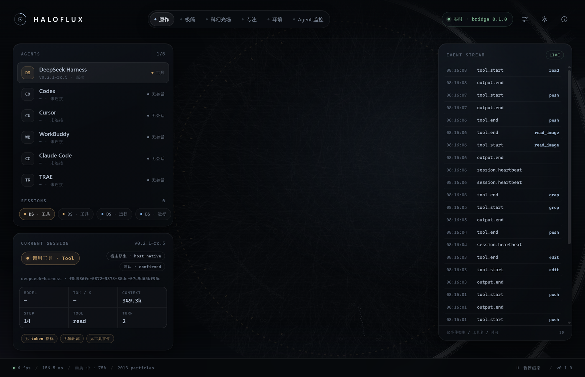
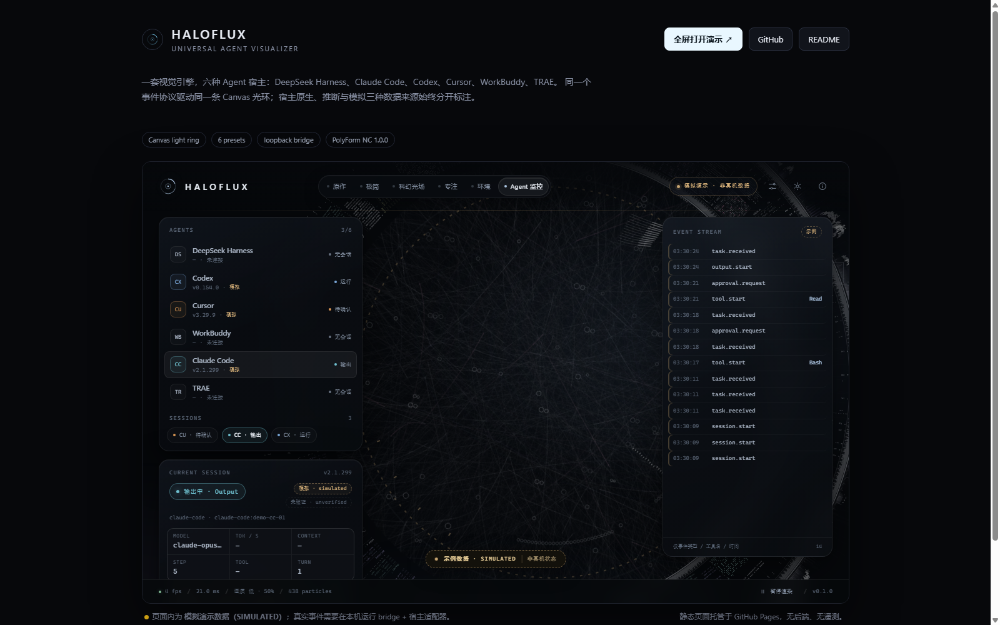
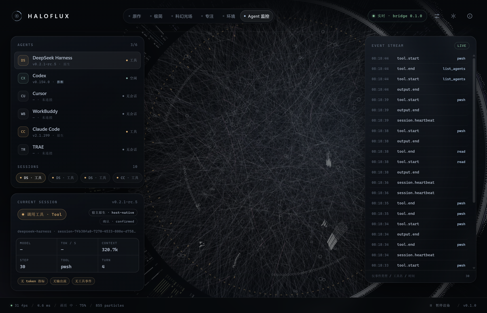
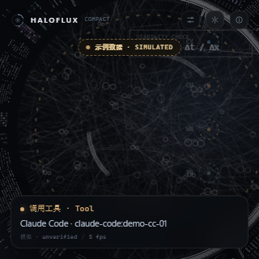
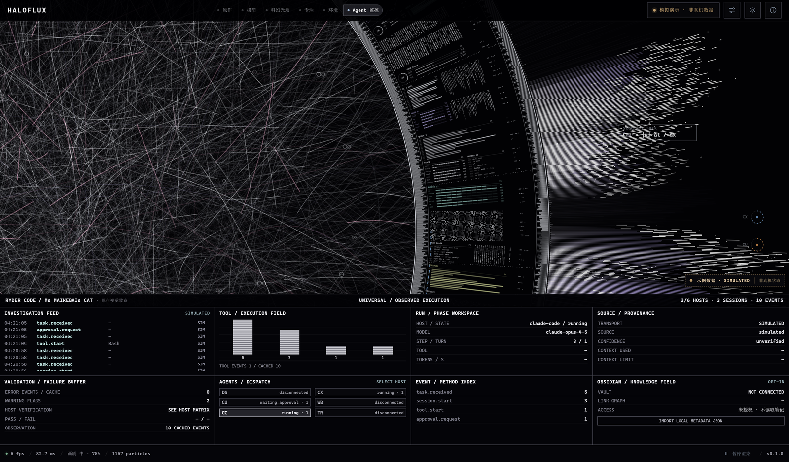
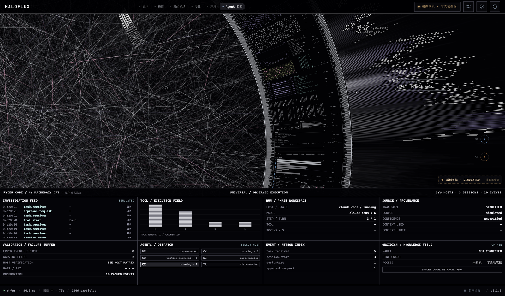
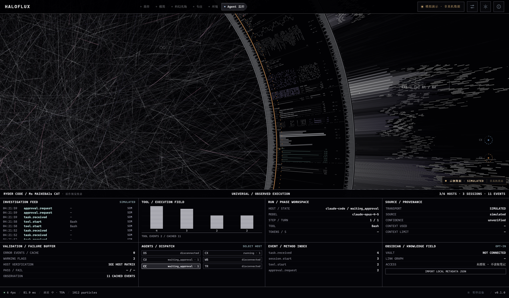
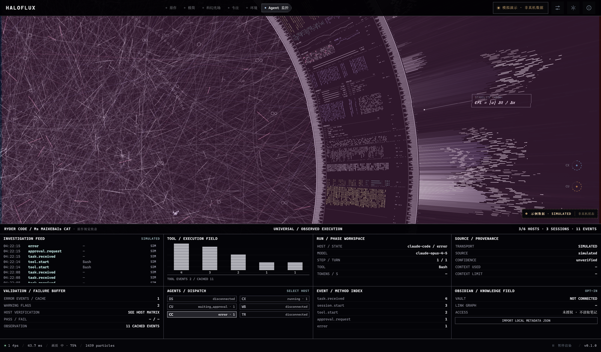
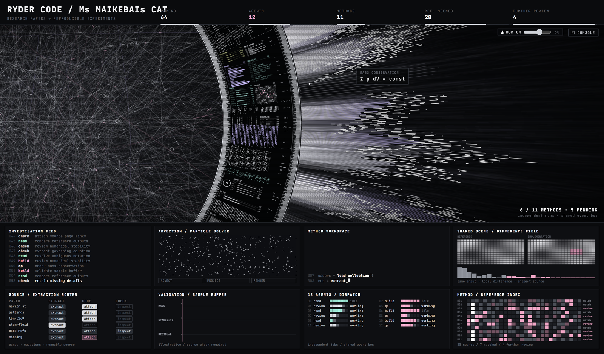

# HALOFLUX Universal Agent Visualizer

[](https://github.com/LYL-Z/haloflux-universal/actions/workflows/ci.yml)
[](https://lyl-z.github.io/haloflux-universal/)

> 一个视觉引擎，六种 Agent 宿主：DeepSeek Harness、Claude Code、Codex、Cursor、WorkBuddy、TRAE。
> **仅限个人非商业使用（PolyForm Noncommercial 1.0.0）。**

**在线演示（模拟数据）**：https://lyl-z.github.io/haloflux-universal/

[English](README.en.md) · [架构契约](docs/architecture.md) · [宿主矩阵](docs/01-host-capability-matrix.md) · [安全与许可证](docs/03-security-and-license.md) · [已知限制](docs/07-known-limitations.md)

**Paper Lab 监控屏（开发中）**：宽屏 `agent-monitor` 预设新增原作风格的黑白光场与 8 个底部仪表，展示真实可观测的事件类型、工具、宿主状态及来源证据（演示数据必须标为 `SIMULATED`）。这是执行事件监控，**不是 AI 隐藏思维链的读取或复现**。还增加了需用户手动选择文件的 [Obsidian 本地元数据快照导入](docs/obsidian-readonly.md)；实时 Vault 插件尚未实现。

本轮改动的 [原版对比、真实性与后续验收清单](docs/PAPER-LAB-AUDIT-2026-11-09.md)；发布新版本之前应进行同分辨率截图对比和真机长时性能验收。当前线上演示在新代码部署前仍显示旧版。

HALOFLUX 把原作那条"会呼吸、会旋转、会向外发射光束"的 Canvas 光环，变成**真实 Agent 会话的实时可视化**：
会话开始、任务提交、工具调用、输出流、等待审批、结束/出错，都有对应的环形态；并且明确区分
**宿主原生（confirmed）**、**推断（inferred）** 与 **模拟（simulated）** 三种数据来源，绝不把猜测画成事实。



> `screenshots/companion-live-dsh.png`：真实 DSH 会话（host-native / confirmed），事件流 30 条，工具名 pwsh / read / grep / edit。

---

## 1. 项目定位

- **一个协议**：`HALOFLUX event v1`（`packages/event-schema`）——19 种事件、10 种状态、元数据白名单。
- **一个桥**：只监听 `127.0.0.1` 的回环事件桥（`packages/event-bridge`），token 鉴权、SSE 推送、限流与大小上限。
- **六个适配器**：各宿主 hooks / MCP / 只读日志 watcher → 归一化事件；失败一律 exit 0，绝不影响宿主。
- **一个伴随应用**：Electron 透明/置顶/点击穿透窗口（`apps/companion`）——窗口、覆盖层、紧凑三种模式。
- **一个视觉引擎**：HALOFLUX Canvas 光环移植（`packages/visual-core`），6 个预设 + 性能守卫。

## 2. 架构（ASCII）

```
  宿主原生 hook / MCP / 只读日志（prompt 与正文永不离开宿主）
        │
        ▼
  adapters/<host>/adapter.mjs          ← 叶进程，try/catch，exit 0，空 stdout
        │  POST http://127.0.0.1:17817/v1/events   (Bearer token, ≤8 KB/event)
        ▼
  packages/event-bridge                ← 唯一网络入口，仅回环
        │  鉴权 / 大小限制 / Origin·Host 校验 / 限流
        ▼
  packages/session-manager             ← 去重、乱序、超时阶梯、派生状态、SessionView
        │  GET /v1/state     GET /v1/stream (SSE: snapshot + update)
        ▼
  apps/companion (Electron)  ──►  packages/visual-core (Canvas 光环 + 6 预设 + 性能守卫)
        │
        └─ 窗口 / 覆盖层（点击穿透）/ 紧凑模式；HUD 显示 来源＋置信度＋能力芯片
```

数据只走回环：无外部网络、无遥测、无远程脚本。

## 3. 快速开始（Windows 11）

要求：Node.js ≥ 22（本机 v24.16），DeepSeek Harness 自带的 Electron 43.3.0（无需下载）。

```powershell
cd D:\HALOFLUX
npm install                 # 只装 TypeScript 开发依赖
npm run build               # 构建 event-schema
npm test                    # 单元 + e2e + 安全测试

# 启动（bridge + 桌面伴随窗口）
node scripts\haloflux.mjs start
node scripts\haloflux.mjs status     # bridge.ok = true
node scripts\haloflux.mjs stop
```

一键安装（可选，先不影响宿主配置）：

```powershell
powershell -NoProfile -ExecutionPolicy Bypass -File scripts\install.ps1 -SkipAdapters
powershell -NoProfile -ExecutionPolicy Bypass -File scripts\install-adapters.ps1 -All -DryRun   # 预览宿主 hook 改动
```

完整安装/诊断/卸载/回滚见 [docs/05-install-uninstall.md](docs/05-install-uninstall.md)。

## 4. 截图

| 预览 | 说明 |
|---|---|
|  | **GitHub Pages 在线演示**：`https://lyl-z.github.io/haloflux-universal/`（iframe 内为模拟数据） |
|  | 伴随窗口模式（window），真实 bridge 17817 的 DSH 会话数据（31 fps） |
|  | 紧凑模式（320×320） |
|  | `agent-monitor` **旧版截图基线**（模拟数据）；Paper Lab 新监控屏尚待真实浏览器截图验收与替换 |
|  | 完整 HUD：agent 列表、当前会话指标、事件流、来源/置信度徽章 |
|  | `waiting_approval` 状态（强脉冲 + 独立颜色） |
|  | `error` 状态（红蓝故障感 + 持续标记） |
|  | 上游 HALOFLUX `lab.html` 的 "Paper Lab Console" 场景（对比用） |

全部截图：`screenshots/preset-*.png`（6 预设）、`screenshots/state-*.png`（10 状态）、
`screenshots/ui-overview.png`、`screenshots/multi-agent.png`、`screenshots/companion-live-dsh.png`、
`screenshots/bridge-window.png`、`screenshots/visual-compact.png`。

> 截图由 Electron `capturePage` 生成（1600×900 逻辑，DPR 2.5）。仓库内为 **1600px 宽的压缩副本**（便于公开分发）；
> 原始 3840×2250 截图保留在本机 `screenshots/_originals/`，不随仓库发布。
> 截图/CI 路径使用软件渲染（`HALOFLUX_SOFTWARE_RENDER=1`）以保证确定性；真实窗口默认启用 GPU，
> 实测 window 31 fps / overlay 24 fps / compact（320×320 内容视口）24 fps。截图状态栏中的 fps 不是性能结论。

## 5. 宿主状态（2026-11-08 核对）

| 宿主 | 状态 | 证据摘要 |
|---|---|---|
| DeepSeek Harness 0.2.1-rc.5 | **PASS** | 原生 Cordis bundle；真实会话 host-native 事件链 session.start→run.start→task.received→tool.*→output.end；6 个 host-native 会话 |
| Claude Code 2.1.299 | **PARTIAL** | hook 已真实安装（新增 9 条，保留 AgentHaven 28 组）；真实 `claude -p` 生命周期 PASS；宿主未登录 → 工具/完成 BLOCKED |
| Codex CLI 0.154.0 | **PARTIAL** | hooks 已安装 8 条但 hook trust 未生效；真实 rollout 日志只读 watcher 派生事件可用 |
| Cursor 3.29.9 | **PARTIAL** | hooks 已安装 11 条；GUI 无法 headless 驱动，真实事件未触发；合成映射通过 |
| WorkBuddy 5.9.3 | **PARTIAL** | MCP 已安装；真实 trace 只读 watcher 派生 81 个事件（derived/inferred） |
| TRAE CN 3.4.13 | **UNSUPPORTED** | hook 事件规范未证实，安装器拒绝写入；仅合成映射验证（derived/inferred） |

详细的状态定义、证据路径、复现命令见 [docs/01-host-capability-matrix.md](docs/01-host-capability-matrix.md)。
**合成 payload 的 PASS 不算宿主 PASS；没有真实证据就不升级状态。**

## 6. 测试与验证

```powershell
npm test                              # node:test：tests/**/*.test.mjs
npm run test:unit                     # event-schema / settings / visual-core / session-manager
npm run test:e2e                      # 真实 bridge 进程 + SSE + 状态机
npm run test:security                 # 401/413/Origin/Host/路径穿越/回环绑定
node tests/host/<host>.mjs            # 每个宿主的证据脚本（PASS/PARTIAL/SIMULATED/BLOCKED）
node scripts/capture.mjs              # 6 预设 + 10 状态 + UI 总览截图
node scripts/soak.mjs --minutes 5     # fps/heap/CPU 浸泡测试
```

测试不会使用生产端口 17817：bridge 由测试以 17910–17999 随机端口 + 隔离 `HALOFLUX_HOME` 启动。
性能数据见 [docs/06-performance.md](docs/06-performance.md)，最终验证输出见 [docs/08-final-verification.md](docs/08-final-verification.md)。

## 7. 目录结构

```
D:\HALOFLUX\
├─ packages/
│  ├─ event-schema/       事件 v1 类型 + 严格校验器 + JSON Schema（冻结契约）
│  ├─ event-bridge/       回环 HTTP + SSE、token 鉴权、限额、限流
│  ├─ session-manager/    多会话状态机、去重、乱序、超时、SessionView
│  ├─ settings/           设置默认值、校验、原子持久化
│  └─ visual-core/        Canvas 光环引擎、6 预设、性能守卫
├─ adapters/              deepseek-harness / claude-code / codex / cursor / workbuddy / trae / generic
├─ apps/companion/        Electron 主进程 + preload + renderer（无构建步骤）
├─ scripts/               install / uninstall / doctor / launch / capture / soak / operator CLI
├─ tests/                 unit / e2e / security / host 证据脚本
├─ docs/                  架构、P0、宿主矩阵、上游审计、安全、安装、性能、限制、最终验证
├─ screenshots/           全部截图与 capture-report.json
├─ config/backups/        宿主配置修改前的备份 + manifest
└─ upstream/              只读上游副本（HALOFLUX、dsh-haloflux）
```

## 8. 卸载与回滚

```powershell
# 卸载宿主 hook（从备份恢复；-PurgeData 才删除本地 token/日志）
powershell -NoProfile -ExecutionPolicy Bypass -File scripts\uninstall.ps1 -Yes
node scripts\haloflux.mjs restore <时间戳> --dry-run   # 先预览
node scripts\haloflux.mjs restore <时间戳>             # 恢复配置备份
```

项目目录与 `config\backups\` 永不自动删除。详细步骤见 [docs/05-install-uninstall.md](docs/05-install-uninstall.md)。

## 9. 许可证与署名

本项目是 **HALOFLUX** 的非商业衍生作品，整体按 **[PolyForm Noncommercial License 1.0.0](LICENSE)** 发布：
个人学习、研究、教学、私人娱乐可免费使用；**严禁任何商业用途**。

必须保留的署名：

- **HALOFLUX** © 2026 Ryder191（RYDER CODE / Ms MAIKEBAIs CAT）— https://github.com/Ryder191/haloflux
- DeepSeek Harness 移植 **dsh-haloflux** v0.7.1 by Ke-wood — https://github.com/Ke-wood/dsh-haloflux
- 音乐 "Synthwave 421k"（The Cynic Project，CC0）**不随本项目加载**

再分发时必须保留 [`LICENSE`](LICENSE)、[`NOTICE`](NOTICE) 与上述署名；修改版本需标注 "modified from HALOFLUX"。

**2026-11-09 上游许可更新（已同步）**：在任何社交/视频平台发布展示 HALOFLUX 或本衍生作品的视频、录屏、截图、GIF 时，必须在作品本身的文案/标题/简介中注明
`Source: HALOFLUX by Ryder191 — https://github.com/Ryder191/haloflux`（平台不允许链接时写 `GitHub: Ryder191/haloflux`），不得冒充原创，且商业用途仍被禁止。
完整合规说明见 [docs/03-security-and-license.md](docs/03-security-and-license.md)。

## 10. 隐私

- 不读取 prompt、对话正文、文件内容、tool 参数/结果、API Key。
- 事件元数据走白名单；未知字段在 schema 边界被拒绝。
- 只连接 `127.0.0.1`；无遥测、无自动更新、无第三方网络请求。
