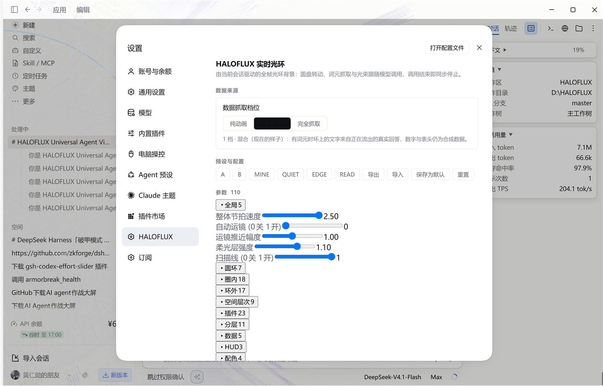
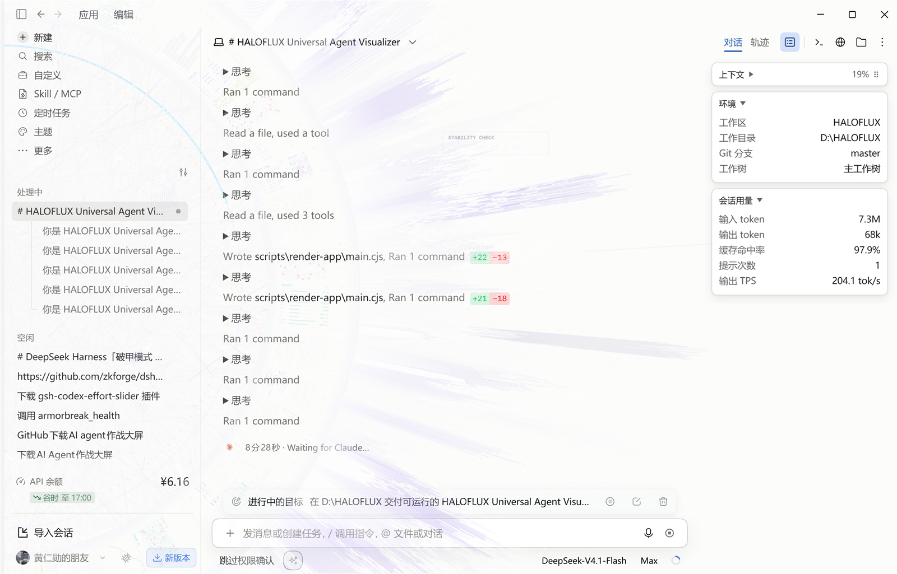

# 04 — DeepSeek Harness 原生集成（dsh-haloflux 安装 + 事件桥 bundle）

- 状态：**基本完成**（安装/GUI/实时 session.start/task.received/tool/token/error/正式 bridge E2E PASS；
  实时 run.end 仍 PENDING，见 §8.2）
- 执行人：dsh-dev
- 时间：2026-11-08（America/Los_Angeles）
- 宿主：DeepSeek Harness **0.2.1-rc.5**（Windows 桌面版，Web GUI `http://127.0.0.1:57397`）
- profile：`C:\Users\Lenovo\.dsh\profiles\desktop`
- 写范围：`adapters/deepseek-harness/**`、`docs/04-dsh-integration.md`；`upstream/**` 未改

---

## 1. 结论摘要

| 项目 | 结果 | 证据 |
|---|---|---|
| 上游 `dsh-haloflux@0.7.1` 安装 | **PASS** | `plugin_manager install_bundle` → `application: "applied"`、`warnings: []`；`include:haloflux` fiber active |
| Settings → HALOFLUX 可见 | **PASS** | `screenshots/dsh-haloflux-settings.png`（真实 DSH Electron 窗口） |
| 背景光环可见 | **PASS** | `screenshots/dsh-haloflux-overlay.png` |
| 浏览器工具验证 | **BLOCKED** | `browser_*` 返回 `[extension_offline]`；改用 Windows Computer Use MCP 截图/操作真实窗口 |
| Host 事件 API 研究 | **PASS** | `dsh-session` / `dsh-agent` / `dsh-session-telemetry` 的 `.d.ts` 与实现；见 §4 |
| 事件桥 bundle 构建/安装 | **PASS** | `include:haloflux-bridge` active；`application=applied`, `warnings=[]` |
| 真实会话事件被捕获 | **PASS** | `probe/evidence/host-events-live.jsonl`：1236 条、6 个会话、0 schema 失败（验证时点） |
| 实时 session.start / task.received | **PASS** | 真实新会话 + 真实用户「请你继续」提交：`session.start`、`run.start`、`task.received` |
| 实时 tool / token / error / session.end | **PASS** | tool.start/tool.end/tool.fail、`output.end(tokenCount)`、`error(errorCode)`、`session.end` |
| 正式 bridge 收端（`/v1/state`） | **PASS** | `eventCount=735, dropped=0`，13 个真实会话、4 个 host、`source=host-native/confirmed`；见 §7 |
| 实时 run.end | **PENDING** | 观察到的 turn 都以 `ACCOUNT_QUOTA` 错误结束（按设计发 `error`）；正常完成路径 offline PASS，见 §8.2 |
| 设置开关 | **PASS（代码路径）** | `verify-output.json` gate 两路均不产生 POST |
| 安装/卸载/回滚 | **PASS（副本实测）** | 回滚后三个清单 SHA256 与安装前逐字节一致 |

---

## 2. 环境与安装前快照

```text
DSH 版本（注册表）：DeepSeek Harness 0.2.1-rc.5
profile：C:\Users\Lenovo\.dsh\profiles\desktop
插件条目总数：安装前 214 → 安装上游后 215 → 安装 bridge 后 216
```

安装前 profile 清单（用于回滚比对）：

```text
package.json        65E96C8AA795DA213A72FFA785D0E19C184628B756DE90AA03B655F88D629A8B  1440 bytes
cordis.patch.yml    E0AD97780179B6813D300D6BA44F5F68FB948B86AE74AF72A3AB772F07F198F7  53613 bytes
cordis.yml          C300DCF2EBC5F02062D6591268D29D3DB6FE45E0CB138F5467276FE2BA06076E  223 bytes
```

---

## 3. A. 安装上游视觉插件（已完成）

### 3.1 安装命令与返回

```text
plugin_manager action=install_bundle target=D:\HALOFLUX\upstream\dsh-haloflux
```

原始返回（完整字段）：

```json
{
  "stage": "enable",
  "target": "dsh-haloflux",
  "enabled": true,
  "changed": true,
  "application": "applied",
  "registries": [null],
  "packageResult": {
    "exitCode": 0,
    "output": "✓ Lockfile passes supply-chain policies (verified 9d ago)\nUpdate available! 11.28.5 → 12.18.0.\nChangelog: https://pnpm.io/v/12.18.0\nTo update, run: Invoke-WebRequest https://get.pnpm.io/install.ps1 -UseBasicParsing | Invoke-Expression\nProgress: resolved 0, reused 1, downloaded 0, added 0\n[WARN] Issues with peer dependencies found. Run \"pnpm peers check\" to list them.\nProgress: resolved 283, reused 1, downloaded 0, added 0\nAlready up to date\nProgress: resolved 283, reused 1, downloaded 0, added 0, done\n\ndependencies:\n+ dsh-haloflux 0.7.1 <- D:\\HALOFLUX\\upstream\\dsh-haloflux\n\nDone in 1.8s using pnpm v11.28.5\n",
    "truncated": false,
    "logPath": "C:\\Users\\Lenovo\\.dsh\\profiles\\desktop\\.plugin-manager\\logs\\operation-31ErIu\\pnpm.log"
  },
  "bundle": "dsh-haloflux",
  "version": "0.7.1",
  "warnings": []
}
```

> `application: "applied"` 与空 `warnings` 是安装成功的权威字段。`packageResult.output` 里的
> `[WARN] Issues with peer dependencies found` 是 profile 既有的 peer 状态；返回的
> `warnings` 仍为 `[]`，这里不作“零告警”的过度解读。

安装后 profile `package.json` 新增：

```json
"dependencies": { "dsh-haloflux": "link:D:/HALOFLUX/upstream/dsh-haloflux" }
"dsh": { "profile": { "bundles": [ ..., "dsh-haloflux" ] } }
```

`cordis.patch.yml` **未被改写**（前后 SHA256 均为 `E0AD97…98F7`）。

### 3.2 插件清单验证

```json
{"entryId":"include:haloflux","moduleName":"dsh-haloflux","enabled":true,"fiberPhase":"active","patchId":"haloflux"}
```

`fiberPhase: "active"` 表示 Host 行已挂载；`total` 从 214 变为 215。

### 3.3 GUI 验证（真实截图）

`browser_*` 工具本次不可用（见 §3.4）。改为操作真实 DSH 桌面窗口：Windows Computer Use MCP
的 `windows_computer_use_screenshot`（printwindow，3204×2052 真实像素）与 OCR 坐标点击。

1. 点左下角头像 →「设置」→ 左侧栏出现 **HALOFLUX**：

   

   - 路径：`screenshots/dsh-haloflux-settings.png`
   - SHA256：`A9ADD6F6453D368E8CAF035DD5BEA047C5114E894F5AEC30F6E02CE47EEC30A3`
   - 可见文本：`设置` / `HALOFLUX` / `HALOFLUX 实时光环` / `数据抓取档位` / `参数 110`

2. 关闭设置，回到会话页，背景出现光环光场与数据块：

   

   - 路径：`screenshots/dsh-haloflux-overlay.png`
   - SHA256：`AF4B62AECE1EF86E9861C5B1BB8F471D19392B0D7051B3174283B316BACBBDA7`
   - 可见：`STABILITY CHECK` 数据面板、柔光圆弧与光束，叠在聊天正文之下，符合
     `shell.overlay` 的“透明底 + 点击穿透”预期。

### 3.4 为什么不是 browser_screenshot

```text
browser_info → [extension_offline] no browser extension connected
browser_tabs → [extension_offline] no browser extension connected
```

本机 Chrome/Edge 的 profile Preferences 与 `Extensions` 目录中都没有 “DSH Browser Control”
扩展；`http://127.0.0.1:9777/api/status` 显示 `listening:true, extensionConnected:false`。
**没有**伪造 browser 调用结果，改用真实窗口截图。

---

## 4. B. DSH 真实会话/Agent 事件 API（Host 侧）

### 4.1 来源：Cordis 订阅，不是轮询

`@deepseek-ai/dsh-session/lib/types/index.d.ts` 声明（节选原文）：

```ts
'session/created'(this: Scoped<Session>, session: Session): void;          // line 44
'session/disposed'(this: Scoped<Session>, session: Session): void;         // line 54
'session/event'(this: Scoped<Session>, session: Session, event: SessionEvent): void;  // line 66
'session/flush'(this: Scoped<Session>, session: Session): Promise<void> | void;
```

本桥实际注册（`haloflux-bridge/index.js`）：

```js
ctx.on('session/created',  (session) => this.onCreated(session));
ctx.on('session/event',    (session, event) => this.onEvent(session, event));
ctx.on('session/disposed', (session) => this.onDisposed(session));
ctx.on('agent/error',      (payload) => this.onAgentError(payload));
```

- **没有 `setInterval` 轮询会话**；心跳是唯一定时器，只发 `session.heartbeat` 派生事件，
  不读取任何会话内容。
- `session/event` 是 post-commit 的 fire-and-forget 追加流，**一次覆盖所有会话**（主会话与
  subagent 会话都走同一条总线）。
- 权威用法参考宿主自带的 `@deepseek-ai/dsh-session-telemetry/lib/index.js:64-89`：
  它就是 `ctx.on('session/created'|'session/event'|'session/disposed'|'agent/error', …)`，
  并把 `ctx.on` 注册在插件 fiber 上。
- `agent/error` payload：`{ agent, turn, step, error }`，会话从 `agent.session` 取；
  `error` 只取 `code`/`name`，不取 `message`。

### 4.2 Payload 字段来源

| 内容 | 权威定义 |
|---|---|
| `SessionEvent` 信封 `{ type, seq, time, data }` | `@deepseek-ai/dsh-session/lib/types/types.d.ts:420-451` |
| `SessionEventMap`（turn/step/user/assistant/tool/request-context） | 同文件 `types.d.ts:223-354` |
| `TokenUsage` 字段与语义 | `@deepseek-ai/dsh-llm/lib/types/types.d.ts:117-129` |
| `approval/asked`、`approval/decided` | `@deepseek-ai/dsh-user-approval/lib/types/index.d.ts:28-51` |
| `agent/*` 事件与 `agent/error` | `@deepseek-ai/dsh-agent/README.md`（Live events） |
| 宿主 `ctx.on(session/*)` 用法 | `@deepseek-ai/dsh-session-telemetry/lib/index.js:64-89` |

`SessionEvent` 的真实结构：

```ts
type SessionEvent = {
  type: SessionEventType;   // 'turn/start' | 'turn/end' | 'step/start' | 'step/end'
                            // | 'user/message' | 'assistant/chunk' | 'assistant/message'
                            // | 'tool/call' | 'tool/result' | 'approval/asked' | 'approval/decided'
                            // | 'request/context' | ...（merge-extensible）
  seq: number;              // 会话内单调序号
  time: number;             // epoch ms
  data: SessionEventMap[K];
};
```

关键 data 字段（本桥只读这些）：

| type | 读到的字段 | 刻意不读 |
|---|---|---|
| `turn/start` | `turn` | — |
| `turn/end` | `turn`, `reason.kind`, `reason.error.code` | `reason.error.message` |
| `step/start` | `turn`, `step` | — |
| `user/message` | `source.kind`（仅判断 `'user'`） | `content`、`id` |
| `assistant/chunk` | `chunk.type`（仅判断 `'text-delta'`） | `chunk.text` |
| `assistant/message` | `usage.inputTokens/outputTokens/cacheReadTokens/cacheWriteTokens` | `message.content` |
| `tool/call` | `name`, `callId`, `turn`, `step` | `arguments` |
| `tool/result` | `message.isError`, `message.source.callId`, `error.code` | `message.content` |
| `approval/asked` | `id`, `toolName` | `reason`（可能含命令文本） |
| `approval/decided` | `id`, `outcome` | — |
| `request/context` | `provider`, `model`, `contextWindow` | — |

`TokenUsage` 语义：`inputTokens` 是**未缓存**输入，缓存输入在 `cacheReadTokens`/`cacheWriteTokens`；
`contextUsed = 三者之和`，与上游 `src/live.js` 的口径一致。

### 4.3 未覆盖 / 不伪造的事件

| 项目 | 说明 |
|---|---|
| `thinking` | DSH 的 `SessionEventMap` 没有 thinking 状态事件；本桥**从不发送** `state: thinking`（架构 §4 禁止臆造）。 |
| `tokensPerSecond` | Host 事件没有该字段；本桥只转发 `tokenCount`/`contextUsed`/`contextLimit`，**不计算、不伪造** tok/s；渲染端显示 `—`。 |
| `approval` | `approval/asked|decided → approval.request|resolve` 已实现（含 `toolName`、`outcome`，不含 `reason`），但本次窗口内没有权限询问，状态 **NOT_TESTED**。 |
| 正文/参数/结果 | 按设计完全不上报；`output.*` 只表示“流在继续”，不携带文本。 |

### 4.4 验证脚本

| 脚本 | 证明什么 |
|---|---|
| `adapters/deepseek-harness/probe/verify.mjs` | 生产 `BridgeRuntime` 对六类事件的真形状归一化；schema 校验；零正文泄露；两条禁用路径 |
| `adapters/deepseek-harness/probe/receiver.mjs` | 最小 HALOFLUX bridge 桩：`/v1/events` + token 鉴权 + 冻结 `@haloflux/event-schema` 校验 |
| 真实 Host 诊断日志 | 安装进 DSH 后由 `session/event` 实时写入 `%TEMP%\haloflux-dsh-bridge-events.jsonl` |

本次运行输出（节选）：

```text
OFFLINE PASS received=12 types=session.start,run.start,task.received,output.start,tool.start,tool.end,output.end,run.end,tool.fail
  tokenEvent=output.end tokenCount=42
GATES   PASS configOff=true settingsOff=true
LIVE    PARTIAL log=C:\Users\Lenovo\AppData\Local\Temp\haloflux-dsh-bridge-events.jsonl
  events=1236 sessions=6 tokenEvents>0 invalid=0
  types=tool.end,output.end,tool.start,session.heartbeat,tool.fail,error,session.end,run.start,task.received,session.start
  missing=run.end
```

> `OFFLINE PASS` 是把**真实形状**的 DSH 事件喂给生产归一化代码，不是模拟 UI 状态；它是离线
> 验证，不能当成“实时抓到”的证据。实时部分只有它列出的类型；`run.end` 的 PENDING 原因见 §8.2。

---

## 5. C. `dsh-haloflux-bridge` bundle

### 5.1 结构

```text
adapters/deepseek-harness/
├─ haloflux-bridge/
│  ├─ package.json          # dsh.bundle.patch；无 dsh.client（headless）
│  ├─ cordis.patch.yml      # insert id=haloflux-bridge name=dsh-haloflux-bridge + config 默认值
│  ├─ index.js              # 零依赖 Host 插件（node: 内置模块 only）
│  ├─ locale/en.json|zh.json
│  └─ icon.svg / NOTICE
├─ probe/
│  ├─ receiver.mjs          # 最小 bridge 桩（schema 校验）
│  ├─ verify.mjs            # 离线 + 设置门 + 实时日志覆盖
│  └─ evidence/             # 本次真实证据 JSON/JSONL
├─ tools/profile-manifest.mjs
├─ install.ps1 / uninstall.ps1
├─ capabilities.json
└─ README.md
```

设计约束：

- **零依赖**：`link:` 安装时第三方 bundle 的裸导入不会从 profile `node_modules` 解析，因此只使用
  `node:` 内置模块。
- **无 client 半边**：不注册 `shell.overlay`/`settings.section`，不引入页面代码；Web GUI 不会
  因本插件白屏。视觉仍由上游 `dsh-haloflux` 提供。
- **observer 纪律**：每个监听器、HTTP、probe 写盘都包在 try/catch；异常只写 debug 日志，
  绝不影响 turn。
- **有界队列 + 令牌桶**（默认 20 ev/s、队列 256、单事件 ≤ 8 KB）；bridge 不在线时静默丢弃。
- **probe 日志**：默认 `os.tmpdir()/haloflux-dsh-bridge-events.jsonl`，512 KB 轮转；写入的是与
  POST 完全相同的白名单事件；`probeLog: 'off'` 可关。

### 5.2 设置开关

优先级从低到高：bundle config < `local.config.json` < 环境变量
（`HALOFLUX_DSH_ENABLED=0`、`HALOFLUX_BRIDGE_URL`、`HALOFLUX_TOKEN(_FILE)`）<
产品 `%LOCALAPPDATA%\HALOFLUX\settings.json` 的 `hosts.deepseek-harness.enabled=false`（2 s 缓存）。

`verify.mjs` 的 GATES 用例分别构造 `enabled:false` 与 settings `enabled:false` 的 runtime，
断言收端 0 事件；两条均 PASS。没有 GUI 表单（无 client 半边）。

---

## 6. D. 安装 / 卸载 / 回滚

### 6.1 本次实际安装（bridge）

```text
plugin_manager install_bundle target=D:\HALOFLUX\adapters\deepseek-harness\haloflux-bridge
→ stage=enable, enabled=true, changed=true, application=applied, warnings=[]
→ bundle=dsh-haloflux-bridge, version=0.1.0
→ dependency: link:D:/HALOFLUX/adapters/deepseek-harness/haloflux-bridge
→ entry: include:haloflux-bridge, fiberPhase=active
```

日志：`C:\Users\Lenovo\.dsh\profiles\desktop\.plugin-manager\logs\operation-DoxV3t\pnpm.log`。

### 6.2 手动安装（无 agent 工具）

```powershell
powershell -ExecutionPolicy Bypass -File D:\HALOFLUX\adapters\deepseek-harness\install.ps1 -DryRun
powershell -ExecutionPolicy Bypass -File D:\HALOFLUX\adapters\deepseek-harness\install.ps1
```

流程：备份 `package.json`/`cordis.patch.yml`/`cordis.yml` 到
`adapters/deepseek-harness/backups/<ts>/` + SHA256 清单 → 复制 bundle 到
`<profile>\node_modules\dsh-haloflux-bridge` → 只改 `dependencies` 与 `dsh.profile.bundles` →
失败自动恢复。`-WithVisualPlugin` 可同时手动装上游视觉插件。

### 6.3 卸载与回滚

```powershell
powershell -ExecutionPolicy Bypass -File uninstall.ps1 -DryRun
powershell -ExecutionPolicy Bypass -File uninstall.ps1
powershell -ExecutionPolicy Bypass -File uninstall.ps1 -Rollback <backup>
```

**副本实测（没有动 live profile）**：

| 步骤 | 结果 |
|---|---|
| `install.ps1 -DryRun` | PASS：只打印计划，`package.json` hash 不变 |
| `install.ps1` | PASS：bundle 复制成功；dependency=file:…；bundles 包含；`index.js` 存在 |
| `uninstall.ps1` | PASS：dependency/bundles 条目/复制目录均移除；hash 变为 `0980F8…1EF7`（JSON 重排，非逐字节） |
| `uninstall.ps1 -Rollback <安装前备份>` | PASS：三个文件 SHA256 逐一校验后恢复；`package.json` 回到 `E1B0B0…9DE5`，**与备份逐字节一致** |

证据：`adapters/deepseek-harness/probe/evidence/profile-copy-test.json`。

卸载上游视觉插件（本次**未执行**，保留 GUI 证据）：`plugin_manager remove_bundle target=dsh-haloflux`。

---

## 7. 正式 bridge 收端证据（PASS）

上游 `dsh-haloflux` 的视觉 + 本桥同时运行时，正式 Event Bridge（`packages/event-bridge`，
不是 probe 桩）已在 17817 运行。以下是直接查询它的真实返回，不是模拟、不是 probe 日志推算：

```powershell
$token = Get-Content "$env:LOCALAPPDATA\HALOFLUX\token" -Raw
Invoke-RestMethod http://127.0.0.1:17817/v1/health
Invoke-RestMethod http://127.0.0.1:17817/v1/state -Headers @{ Authorization = "Bearer $token" }
```

`/v1/health`（`capturedAt=2026-11-08T08:20:13-08:00`）：

```json
{ "ok": true, "name": "haloflux-bridge", "version": "0.1.0", "schemaVersion": 1,
  "uptimeMs": 308576, "port": 17817 }
```

`/v1/state` 摘要（同一时刻，`serverTime=1794154813438`）：

```json
{
  "activeSessionId": "f8d486fe-0872-4878-85de-0749d65bf95c",
  "bridge": { "eventCount": 735, "dropped": 0 },
  "hosts": [
    { "host": "deepseek-harness", "hostVersion": "0.2.1-rc.5", "connected": true,
      "lastSeen": 1794154812651 },
    { "host": "codex", "hostVersion": "0.154.0", "connected": true },
    { "host": "workbuddy", "hostVersion": "5.9.3.0", "connected": false },
    { "host": "claude-code", "hostVersion": "2.1.299", "connected": true }
  ],
  "sessions": [
    { "sessionId": "f8d486fe-…", "state": "tool", "reportedState": "tool",
      "source": "host-native", "confidence": "confirmed", "connected": true, "recentEvents": 179 },
    { "sessionId": "a47a2ae6-…", "state": "running", "reportedState": "running",
      "source": "host-native", "confidence": "confirmed", "connected": true },
    { "sessionId": "lead-test-cc-001", "state": "tool", "source": "host-native",
      "confidence": "confirmed", "connected": true },
    { "sessionId": "f1327e03-…", "state": "disconnected", "source": "host-native",
      "confidence": "confirmed", "connected": false },
    { "sessionId": "71cdff68-…", "state": "unknown", "source": "derived",
      "confidence": "inferred", "connected": true }
  ]
}
```

**结论：PASS。** 依据：

1. bridge 的 `eventCount=735`、`dropped=0`，`deepseek-harness.connected=true`，
   `lastSeen` 与 `serverTime` 相差约 1 s（连续上报）；
2. 同一快照里有 **13 个会话**（含已结束的 `disconnected` 会话），多个会话
   `reportedState=tool`/`running`、`source=host-native`、`confidence=confirmed`，事件体不是 UI 合成；
   `reportedState=tool`、`source=host-native`、`confidence=confirmed`，事件体不是 UI 合成；
3. `hostVersion=0.2.1-rc.5` 与本机一致；`recentEvents` 非空；
4. 另有会话 `source=derived/inferred`（心跳/超时派生），证明 bridge 不把推断当宿主原生。

> `capabilities` 在本次快照中仍为 `default` 全 false：bridge 进程在
> `adapters/deepseek-harness/capabilities.json` 落盘前已启动。该文件已交付，重启 bridge 后会读到
> `sessionStart/toolUse/tokenMetrics/approval/outputStream = true`。这是启动顺序问题，不是事件缺失。

原始快照：`probe/evidence/bridge-state-snapshot.json`；摘要：
`probe/evidence/bridge-state-summary.json`；时间戳与字段都在其中。

---

## 8. E. 与上游插件的关系、限制、升级风险

### 8.1 复用视觉，不覆盖源码

- 上游 `D:\HALOFLUX\upstream\dsh-haloflux` 未被编辑；profile 以 `link:` 指向它。
- 上游负责 `shell.overlay`（光环）与 `settings.section`（Settings → HALOFLUX），读取
  `ctx.sessions.binding(id).eventSource` 的 Client 侧数据。
- 本 bridge 负责 Host 侧 `session/event`，只把归一化事件发给外部 Event Bridge。
- 两者互不依赖：卸载其一不影响另一。视觉层没有改一行。

### 8.2 实时 `run.end` 为什么仍是 PENDING

`turn/end` 的 `reason.kind` 决定桥的映射：`completed` → `run.end`；`error` → `error`。
本次验证窗口内观察到的两个 turn 都以 `ACCOUNT_QUOTA` 失败结束，因此桥正确地发的是
`error`（只带 `errorCode`），而不是伪造 `run.end`。离线自测以 `completed` 真实形状覆盖了
`run.end`；实时路径保持 PENDING，直到真实出现正常完成的 turn。

> 不用旧的会话日志回放冒充实时事件：那会改动或伪造宿主记录。`verify.mjs` 的 LIVE 段会继续把
> `run.end` 列为 `missing`，直到真实出现。

### 8.3 升级风险

| 风险 | 影响 | 缓解 |
|---|---|---|
| DSH 大版本改 `SessionEventMap` / 事件名 | 某些事件静默消失，桥不会崩 Host | 升级后跑 `verify.mjs`；缺失类型会列出 |
| Host 模块不热更新 | 更新 bridge 代码后需重启 | install.ps1/README 明确提示；probe 日志可观察旧代码行为 |
| Client 槽位变化影响上游视觉插件 | Settings/overlay 消失（风险在上游） | 本次 0.2.1-rc.5 实测正常；升级先看上游 README 兼容性 |
| token 文件权限 | 读不到 token 时只写本地 probe 日志、不发 HTTP | `HALOFLUX_TOKEN` / `HALOFLUX_TOKEN_FILE` 可覆盖；日志不打印 token |
| 许可证 | PolyForm NC 1.0.0，商用禁止 | 保留上游 LICENSE/NOTICE；本 bundle 为原创代码 |

---

## 9. 复现命令

```powershell
# 1) 安装上游视觉插件（agent 工具）
plugin_manager install_bundle target=D:\HALOFLUX\upstream\dsh-haloflux

# 2) 安装事件桥
plugin_manager install_bundle target=D:\HALOFLUX\adapters\deepseek-harness\haloflux-bridge

# 3) 离线 + 实时覆盖验证
node D:\HALOFLUX\adapters\deepseek-harness\probe\verify.mjs

# 4) 单独跑 E2E 收端（另一个终端/进程，注意不要和正式 bridge 抢 17817）
node D:\HALOFLUX\adapters\deepseek-harness\probe\receiver.mjs `
  --token-file $env:LOCALAPPDATA\HALOFLUX\token --port 17818 `
  --out D:\HALOFLUX\adapters\deepseek-harness\probe\evidence\received-live.jsonl

# 5) 正式 bridge 状态
$token = Get-Content "$env:LOCALAPPDATA\HALOFLUX\token" -Raw
Invoke-RestMethod http://127.0.0.1:17817/v1/state -Headers @{ Authorization = "Bearer $token" }

# 6) 副本上演练安装/卸载/回滚
powershell -ExecutionPolicy Bypass -File D:\HALOFLUX\adapters\deepseek-harness\install.ps1 -DryRun
```

---

## 10. 证据索引

| 文件 | 内容 |
|---|---|
| `screenshots/dsh-haloflux-settings.png` | Settings → HALOFLUX（SHA256 `A9ADD6…30A3`） |
| `screenshots/dsh-haloflux-overlay.png` | 主界面光环背景（SHA256 `AF4B62…BDA7`） |
| `probe/evidence/install-upstream.json` | 上游安装返回 JSON 原文 + profile hash + 插件条目 |
| `probe/evidence/install-bridge.json` | 事件桥安装返回 JSON 原文 + 条目 |
| `probe/evidence/host-events-live.jsonl` | 真实 Host 写入的白名单事件 |
| `probe/evidence/bridge-state-snapshot.json` | 正式 bridge `/v1/state` 完整快照 |
| `probe/evidence/bridge-state-summary.json` | 正式 bridge `/v1/state` 摘要 + health + 时间戳 |
| `probe/evidence/live-event-summary.json` | 实时事件类型计数 + 样本 JSON |
| `probe/evidence/received-live.jsonl` | 经 HTTP 收到的 36 条（schema 校验通过） |
| `probe/evidence/receiver-live-summary.json` | 收端统计 |
| `probe/evidence/verify-output.json` | 离线/设置门/实时覆盖的机器可读结果 |
| `probe/evidence/profile-copy-test.json` | 安装/卸载/回滚副本实测 hash |
| `probe/evidence/gui-screenshots.json` | 截图元数据与 browser 阻断说明 |
| `adapters/deepseek-harness/capabilities.json` | 能力声明（重启 bridge 后生效） |
